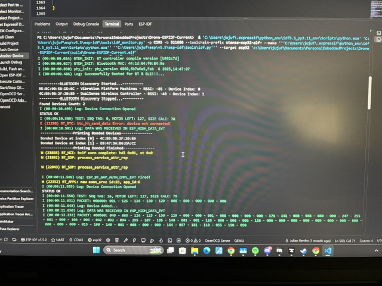
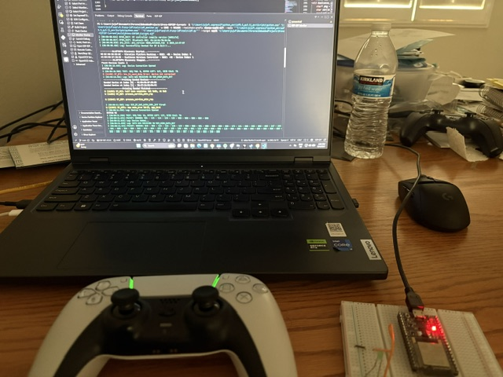

# ESP32 Dualsense (PS5) Controller Driver

This is a project utilizing ESP32 BT Classic to interface with a dualsense controller to allow full capabilities. This allows for sending & recieving packets to / from the controller and allows full capabilities with lights, gyroscope, microphone, sticks, buttons, touchpad, etc. \

## Media
The image below showcases a terminal with real-time packets being recieved. \

\
The Image below Showcases proof of the driver working with the Green lightbar. This is impossible to change without the driver (Normally blue). \

